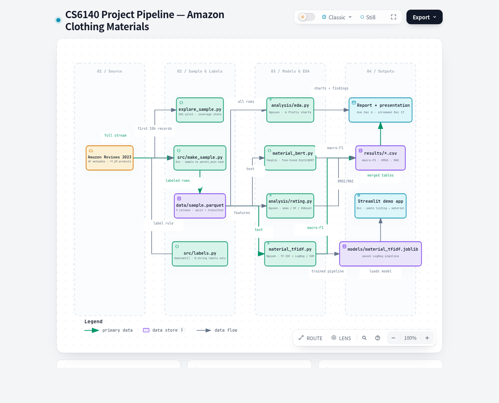

# What Is It Made Of?

**Predicting clothing material and buyer ratings from Amazon product listings**


A final project for CS6140 Machine Learning (Fall 2026, Northeastern University — Silicon Valley Campus, Prof. Mohammadhossein Toutiaee), built by a team of three graduate students.

Clothing material drives comfort, durability, and how a product ages, yet on Amazon it is usually buried in free-text feature bullets instead of a searchable field. We study two questions on the same listings:

| Task | Question | Type | Primary metrics |
|---|---|---|---|
| **A — Material** | Can a model infer a product's dominant material from its listing text? | Multi-class classification | Macro-F1 (plus per-class F1) |
| **B — Rating** | Do material, price, and department help predict the product's average rating? | Regression | RMSE, MAE |



## Dataset

We use the Clothing, Shoes and Jewelry metadata of [Amazon Reviews 2023](https://amazon-reviews-2023.github.io/) (Hou et al., McAuley Lab): about 7.2 million products, each with a title, feature bullets, description, price, department, and average rating. The current results use a **pilot of the first 10,000 records**; the reproducible ~250k-record sample (`src/make_sample.py`, 249,762 rows) is built and the models will be rerun on it. On that sample only 36.4% of listings are labeled and 79.8% lack a price, so the pilot shares below are not representative. Raw data is never committed — the `data/` folder is gitignored.

Labels are not given; we extract them. A label is the highest-percentage fiber in a composition string such as "90% Polyester, 10% Spandex" (ties go to the first fiber listed). Only listings that carry such a string can be labeled:

| Pilot EDA (10,000 listings) | Share |
|---|---|
| Listings with a percentage composition in their bullets | 46.0% |
| Listings with material in a structured details field | 3.6% |
| Listings that name a known material anywhere | 79.0% |
| Listings with a missing price | 45.7% |

Among labeled listings, polyester (~34%) and cotton (~31%) dominate, followed by leather (~13%). Classes with fewer than 20 labeled rows are dropped for the pilot, leaving 9 classes (3,641 train / 903 test). Task B uses all 10,000 listings (8,046 train / 1,954 test).

## Approach

**Leakage controls** (the part we are most careful about):

- The composition strings the label is parsed from are **removed from the model input text**, so Task A is not a lookup of the answer key.
- Task A never uses `average_rating` or `rating_number` as features.
- In Task B, `rating_number` is never a feature; it is only used as a sample weight (`log1p`), as recorded in [AGENTS.md](AGENTS.md).
- One fixed split (`split` column, seed 42) for every run; the test split is never tuned on.

**Models**

| Task | Model | Status |
|---|---|---|
| A | TF-IDF + logistic regression | ✅ Pilot results below |
| A | TF-IDF + linear SVM | ✅ Pilot results below |
| A | DistilBERT fine-tune (GPU) | ✅ Pilot results below |
| B | Mean baseline | ✅ Pilot results below |
| B | Random forest | ✅ Pilot results below |
| B | XGBoost | ✅ Pilot results below |

Each model family with results (TF-IDF material models, rating models) has a note in [`docs/model-notes/`](docs/model-notes/) explaining how it works, why we chose it for this dataset, and an error analysis with real examples.

## Pilot results (10,000 listings)

### Task A — Material classification

| Model | Macro-F1 | Accuracy |
|---|---|---|
| TF-IDF + logistic regression | **0.5572** | 0.6766 |
| TF-IDF + linear SVM | 0.5239 | **0.7364** |
| DistilBERT (fine-tuned, Colab T4) | 0.3563 | 0.6899 |

Per-class F1 (logistic regression): leather is nearly solved (0.94) and cotton is solid (0.74), while spandex (0.20), wool (0.40), and nylon (0.48) are hard — they are rare and often blended. The most common confusion is polyester ↔ cotton. DistilBERT matches the TF-IDF models on the large classes but never predicts the three rarest fibers (it was trained without class weights), which costs it most of its macro-F1. Full tables, the confusion matrix, and error examples are in [`results/`](results/).

### Task B — Rating prediction

| Model | RMSE | MAE |
|---|---|---|
| Mean baseline | 0.5863 | 0.3834 |
| Random forest | 0.5854 | 0.3851 |
| XGBoost | **0.5780** | **0.3736** |

An honest reading: listing-side features barely beat predicting the mean. Ratings seem to be driven more by fit, quality, and expectations than by what a listing says — we treat that as a finding, not a failure, and the report's analysis section digs into where the remaining error concentrates (hardest group: listings whose material could not be parsed, RMSE 0.677).

## Getting started

Requirements: Python 3.12 or later.

```bash
git clone https://github.com/johnha912/amazon-clothing-material.git
cd amazon-clothing-material
pip install -r requirements.txt

# Pilot data: the first 10,000 clothing metadata records
# (the full category file is several GB)
mkdir -p data
curl -sL https://huggingface.co/datasets/McAuley-Lab/Amazon-Reviews-2023/resolve/main/raw/meta_categories/meta_Clothing_Shoes_and_Jewelry.jsonl | head -n 10000 > data/meta_head.jsonl

python explore_sample.py data/meta_head.jsonl   # label-coverage statistics
python analysis/eda.py                          # EDA charts -> results/eda/
python analysis/material_tfidf.py               # Task A baselines -> results/material_tfidf.csv
python analysis/rating.py                       # Task B models -> results/rating.csv
```

The analysis scripts share one loader ([`analysis/load_data.py`](analysis/load_data.py)). When `data/sample.parquet` exists (built by `src/make_sample.py`) they use it automatically; until then they fall back to the 10k pilot above, with the same schema, labeling rule, and split.

## Repository layout

```
.
├── AGENTS.md                # working rules: ownership, labels, leakage, evaluation, agent roles
├── ai-prompts.md            # log of AI-assistant prompts (course requirement, see below)
├── explore_sample.py        # label-coverage statistics; home of the shared labeling rule
├── analysis/
│   ├── load_data.py         # shared loader (sample.parquet preferred, pilot fallback)
│   ├── eda.py               # exploratory analysis + Plotly charts
│   ├── material_tfidf.py    # Task A: TF-IDF + logistic regression / linear SVM
│   ├── material_bert.py     # Task A: DistilBERT fine-tune (Colab GPU)
│   └── rating.py            # Task B: mean baseline, random forest, XGBoost
├── docs/
│   ├── code-style.md
│   └── model-notes/         # one note per model family: method, rationale, error analysis
├── app/                     # Streamlit demo
├── report/                  # report sections, meeting notes, pipeline figure
├── results/                 # metric CSVs, EDA charts, confusion matrix, error examples
├── src/                     # sample builder, label module and tests, shared evaluation
└── data/, models/           # local only — never committed
```

The DistilBERT weights and Colab notebook are attached to the [`yanglin-distilbert-2026-11-02` release](https://github.com/johnha912/amazon-clothing-material/releases/tag/yanglin-distilbert-2026-11-02), not committed.

## Status and roadmap

- ✅ Proposal submitted; pilot EDA and both baseline families run on 10,000 listings
- ✅ Sample builder: ~250k-listing `data/sample.parquet` (249,762 rows, 36.4% labeled)
- ✅ DistilBERT pilot fine-tune for Task A; first Streamlit demo in `app/`
- 🚧 Re-run all models on the 250k sample
- 📝 Report (max 8 pages) and a 5-minute recorded presentation due **December 6, 2026**

## Team

| Name | Program | GitHub | Main responsibilities |
|---|---|---|---|
| Nguyen Ha | M.S. in Computer Science | [@johnha912](https://github.com/johnha912) | TF-IDF and rating models, EDA, report integration |
| Yanglin Hu | M.S. in Data Science | [@Elliothu-oss](https://github.com/Elliothu-oss) | DistilBERT modeling (lead) |
| Rui Song | M.S. in Computer Science | [@ruisnow-e](https://github.com/ruisnow-e) | Data pipeline (`src/`), demo app, related work |

## Related implementations

We compare our approach with three public Kaggle notebooks on the same dataset family (star-rating prediction, metadata-based recommendation, and EDA) in [`report/sections/related_implementations.md`](report/sections/related_implementations.md), including what each one does and where we try to do better.

## A note on AI assistance

This project is developed with AI assistants under the rules in [AGENTS.md](AGENTS.md) — file ownership per member, cross-tool audits for feature work, and no metric entering the report unless it was produced on the untouched test split. Every assistant prompt is logged in [`ai-prompts.md`](ai-prompts.md), which feeds the "AI Prompts Used" section of the final report.

## References

- Hou, Yupeng, et al. "Bridging Language and Items for Retrieval and Recommendation." *arXiv*, 2024. [arxiv.org/abs/2403.03952](https://arxiv.org/abs/2403.03952) — the Amazon Reviews 2023 dataset paper.
- Chen, Tianqi, and Carlos Guestrin. "XGBoost: A Scalable Tree Boosting System." *Proceedings of the 22nd ACM SIGKDD*, ACM, 2016, pp. 785–94.
- Sanh, Victor, et al. "DistilBERT, a Distilled Version of BERT: Smaller, Faster, Cheaper and Lighter." *arXiv*, 2019. [arxiv.org/abs/1910.01108](https://arxiv.org/abs/1910.01108)

---

Dataset courtesy of the McAuley Lab (UC San Diego). This repository is a course project; code and results are shared for learning and review.
