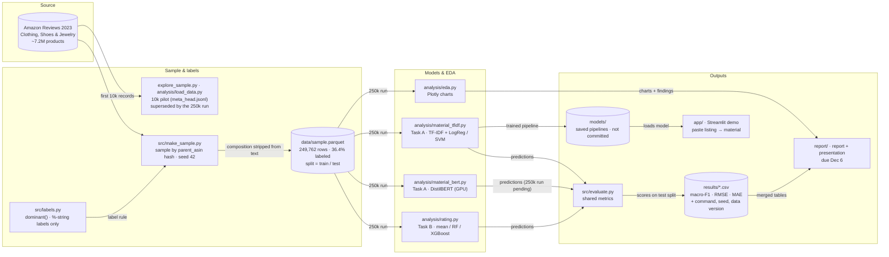

# What Is It Made Of?

**Predicting clothing material and buyer ratings from Amazon product listings**


A final project for CS6140 Machine Learning (Fall 2026, Northeastern University — Silicon Valley Campus, Prof. Mohammadhossein Toutiaee), built by a team of three graduate students.

Clothing material drives comfort, durability, and how a product ages, yet on Amazon it is usually buried in free-text feature bullets instead of a searchable field. We study two questions on the same listings:

| Task | Question | Type | Primary metrics |
|---|---|---|---|
| **A — Material** | Can a model infer a product's dominant material from its listing text? | Multi-class classification | Macro-F1 (plus per-class F1) |
| **B — Rating** | Do material, price, and department help predict the product's average rating? | Regression | RMSE, MAE |



All arrows are steps already run except the DistilBERT track, whose 250k run is still pending. The current numbers come from `data/sample.parquet` (249,762 rows) scored through `src/evaluate.py`; the 10k pilot path is kept only for the pilot findings labeled as such. Source: [`report/assets/project-pipeline.mmd`](report/assets/project-pipeline.mmd).

## Dataset

We use the Clothing, Shoes and Jewelry metadata of [Amazon Reviews 2023](https://amazon-reviews-2023.github.io/) (Hou et al., McAuley Lab): about 7.2 million products, each with a title, feature bullets, description, price, department, and average rating. The current results use the **~250k-record sample**; an earlier pilot on the first 10,000 records is kept only where labeled as pilot. The reproducible sample (`python -m src.make_sample data/meta_Clothing_Shoes_and_Jewelry.jsonl --n 250000`, seed 42, `src/make_sample.py` commit 2219c1e) has been built twice with identical results (Rui Song, and an independent rebuild, both in Issue #1): 249,762 rows, 199,838 train / 49,924 test. On that sample only 36.4% of listings are labeled and 79.8% lack a price, so the pilot shares below are not representative; the TF-IDF and rating models were rerun on it for [Issue #2](https://github.com/johnha912/amazon-clothing-material/issues/2) (DistilBERT is pending). Raw data is never committed — the `data/` folder is gitignored.

Labels are not given; we extract them. A label is the highest-percentage fiber in a composition string such as "90% Polyester, 10% Spandex" (ties go to the first fiber listed). Only listings that carry such a string can be labeled:

| EDA | 250k sample (249,762 listings) | Pilot (10,000 listings) |
|---|---|---|
| Listings with a percentage composition (labeled) | 36.4% (90,979) | 46.0% |
| Listings with material in a structured details field | not recomputed | 3.6% |
| Listings that name a known material anywhere | not recomputed | 79.0% |
| Listings with a missing price | 79.8% | 45.7% |
| Mean average rating | 4.08 | pilot figure not kept |

Among labeled listings in the 250k sample, cotton (33.0%) and polyester (31.3%) dominate, followed by leather (17.3%). The shared labeling code `src/labels.py` and `MIN_CLASS_ROWS = 20` give 10 classes (cotton, polyester, leather, nylon, rayon, other, spandex, wool, rubber, metal), all above the cutoff, with 72,661 train / 18,318 test listings for Task A; Task B uses all 249,762 listings (199,838 train / 49,924 test). The pilot had 9 classes (3,641 train / 903 test) and Task B 8,046 train / 1,954 test, so pilot and 250k scores are not directly comparable. Source: `python analysis/eda.py` and `python analysis/load_data.py` on `data/sample.parquet (249,762 rows, make_sample.py 2219c1e)`, seed 42. Shoes stay in scope: dropping the 113 shoe rows from the pilot test set changes macro-F1 by -0.017 to -0.019 for the three models, and every bootstrap 95% confidence interval of that change includes 0, but 105 of the 115 leather test rows are shoes, so the leather class mostly measures footwear.

## Approach

**Leakage controls** (the part we are most careful about):

- The composition strings the label is parsed from are **removed from the model input text** so Task A is not a lookup of the answer key. The shared `strip_composition` in `src/labels.py` missed some (13,373 of 90,979 labeled listings kept a percentage sign), so `analysis/load_data.py` now blanks every clause holding a digit followed by a percent sign when it reads the sample; its self-check passes (no digit followed by a percent sign remains in any labeled text), and 405 labeled listings whose whole text was such a clause are kept with empty text. 42 labeled listings still contain a stray percent sign in forms the labeling rule does not read, and 1,048 spell out "N percent"; a stricter cleaner is left for later.
- Task A never uses `average_rating` or `rating_number` as features.
- In Task B, `rating_number` is never a feature; it is only used as a sample weight (`log1p`), as recorded in [AGENTS.md](AGENTS.md).
- One fixed split (`split` column, seed 42) for every run; the test split is never tuned on.

**Models**

| Task | Model | Status |
|---|---|---|
| A | TF-IDF + logistic regression | ✅ 250k results below |
| A | TF-IDF + linear SVM | ✅ 250k results below |
| A | DistilBERT fine-tune (GPU) | 🚧 Pilot result only; 250k run pending |
| B | Mean baseline | ✅ 250k results below |
| B | Random forest | ✅ 250k results below |
| B | XGBoost | ✅ 250k results below |

Each model family with results (TF-IDF material models, DistilBERT, rating models) has a note in [`docs/model-notes/`](docs/model-notes/) explaining how it works, why we chose it for this dataset, and an error analysis with real examples.

## Results on the 250k sample

All numbers: data version `data/sample.parquet (249,762 rows, make_sample.py 2219c1e)`, seed 42, test split, scored through `src/evaluate.py` with `python analysis/material_tfidf.py` and `python analysis/rating.py`. Confidence intervals are pending (they will be computed from `results/material_tfidf_predictions.csv` and `results/rating_predictions.csv`).

### Task A — Material classification (10 classes, 72,661 train / 18,318 test)

| Model | Macro-F1 | Accuracy | 95% CI |
|---|---|---|---|
| TF-IDF + logistic regression | 0.5799 | 0.7326 | pending |
| TF-IDF + linear SVM | **0.6203** | **0.7872** | pending |

The SVM is higher on both metrics and on every class on this test set (the pilot had logistic regression ahead on macro-F1). Per-class F1 (logistic regression): leather is nearly solved (0.943) and cotton is solid (0.811), while metal (0.224, only 27 test rows) and spandex (0.324) are lowest. The largest confusions are polyester predicted as rayon (574), nylon (555), and cotton (549), and cotton as polyester (528). An earlier run on text that still held some percentage strings scored 0.6397 / 0.6932; the leak is fixed and these numbers use the cleaned text. Full tables, the confusion matrix, and error examples are in [`results/`](results/).

### Task A — DistilBERT (pilot only, 250k run pending)

| Model | Macro-F1 | Accuracy | Test rows |
|---|---|---|---|
| DistilBERT (fine-tuned, Colab T4), pilot | 0.3563 | 0.6899 | 903 pilot rows, 9 classes |

This is a pilot number on different test rows and a different class list, so it is not comparable with the 250k table above; the 250k DistilBERT run (Yanglin Hu) is pending. Pilot detail: for the pilot, TF-IDF + logistic regression scored 0.5572 and the SVM 0.5239 on the same 903 rows. DistilBERT matches or beats logistic regression on cotton, polyester, leather, and nylon but gets none of the three rarest fibers right (polyurethane, spandex, and wool, F1 0), which accounts for about 60% of its macro-F1 gap; rayon (F1 0.07) and acrylic account for the rest. One untested explanation is that DistilBERT was fine-tuned without class weights while the TF-IDF models use balanced weights. All three models were scored on the same 903 test rows (matching `test_ids_sha256` in [`results/material_comparison.csv`](results/material_comparison.csv)); these are single-seed pilot numbers without confidence intervals. The DistilBERT row is provisional until its independent audit. Full tables, the confusion matrix, and error examples are in [`results/`](results/).

### Task B — Rating prediction (199,838 train / 49,924 test, 250k sample)

| Model | RMSE | MAE |
|---|---|---|
| Mean baseline | 0.7512 | 0.5385 |
| Random forest | 0.7647 | 0.5509 |
| XGBoost | **0.7373** | **0.5234** |

An honest reading: listing-side features barely beat predicting the mean (XGBoost is 1.9% lower in RMSE, our arithmetic), and the random forest is worse than the baseline on this test set. Ratings seem to be driven more by fit, quality, and expectations than by what a listing says — we treat that as a finding, not a failure, and the report's analysis section digs into where the remaining error concentrates (hardest group: listings whose material could not be parsed, RMSE 0.7846). The pilot (10,000 listings, 1,954 test rows) gave RMSE 0.5863 / 0.5854 / 0.5780, not comparable with the above.

## Getting started

Requirements: Python 3.12 or later.

```bash
git clone https://github.com/johnha912/amazon-clothing-material.git
cd amazon-clothing-material
pip install -r requirements.txt

# Pilot data: the first 10,000 clothing metadata records
# (the full category file is several GB)
mkdir -p data
curl -sL https://huggingface.co/datasets/McAuley-Lab/Amazon-Reviews-2023/resolve/main/raw/meta_categories/meta_Clothing_Shoes_and_Jewelry.jsonl | head -n 10000 > data/meta_head.jsonl

python explore_sample.py data/meta_head.jsonl   # label-coverage statistics
python analysis/eda.py                          # EDA charts -> results/eda/
python analysis/material_tfidf.py               # Task A baselines -> results/material_tfidf.csv
python analysis/rating.py                       # Task B models -> results/rating.csv

# Optional: the ~250k sample (downloads the full 18 GB category file;
# building the sample then took about 3 minutes on an Intel Core 7 150U laptop)
curl -L -C - -o data/meta_Clothing_Shoes_and_Jewelry.jsonl https://huggingface.co/datasets/McAuley-Lab/Amazon-Reviews-2023/resolve/main/raw/meta_categories/meta_Clothing_Shoes_and_Jewelry.jsonl
python -m src.make_sample data/meta_Clothing_Shoes_and_Jewelry.jsonl --n 250000   # -> data/sample.parquet
```

The analysis scripts share one loader ([`analysis/load_data.py`](analysis/load_data.py)). When `data/sample.parquet` exists (built by `src/make_sample.py`) they use it automatically; until then they fall back to the 10k pilot above, with the same schema, labeling rule, and split.

## Repository layout

```
.
├── AGENTS.md                # working rules: ownership, labels, leakage, evaluation, agent roles
├── ai-prompts.md            # log of AI-assistant prompts (course requirement, see below)
├── explore_sample.py        # label-coverage statistics; home of the shared labeling rule
├── analysis/
│   ├── load_data.py         # shared loader (sample.parquet preferred, pilot fallback)
│   ├── eda.py               # exploratory analysis + Plotly charts
│   ├── material_tfidf.py    # Task A: TF-IDF + logistic regression / linear SVM
│   ├── material_bert.py     # Task A: DistilBERT fine-tune (Colab GPU)
│   └── rating.py            # Task B: mean baseline, random forest, XGBoost
├── docs/
│   ├── code-style.md
│   ├── method-analysis-sources.md  # the five Method/Analysis papers and how we use them
│   └── model-notes/         # one note per model family: method, rationale, error analysis
├── app/                     # Streamlit demo
├── report/                  # report sections (one shared reference list), pipeline figure
├── results/                 # metric CSVs, EDA charts, confusion matrix, error examples
├── src/                     # sample builder, label module and tests, shared evaluation
└── data/, models/           # local only — never committed
```

The DistilBERT weights and Colab notebook are attached to the [`yanglin-distilbert-2026-11-02` release](https://github.com/johnha912/amazon-clothing-material/releases/tag/yanglin-distilbert-2026-11-02), not committed.

## Status and roadmap

- ✅ Proposal submitted; pilot EDA and both baseline families run on 10,000 listings
- ✅ Sample builder: ~250k-listing `data/sample.parquet` (249,762 rows, 36.4% labeled)
- ✅ DistilBERT pilot fine-tune for Task A; first Streamlit demo in `app/`
- ✅ Week 1 closed ([Issue #1](https://github.com/johnha912/amazon-clothing-material/issues/1)): same test rows confirmed for all three Task A models, shoe scope decided, Related Work and Related Implementations drafted
- ✅ Five more papers cited in the Method and Analysis drafts; all report references merged into one list
- ✅ Week 2 ([Issue #2](https://github.com/johnha912/amazon-clothing-material/issues/2)), TF-IDF and rating models: rerun on the 250k sample through `src/evaluate.py`
- 🚧 Still open for Issue #2: DistilBERT on the 250k sample (Yanglin Hu), 95% confidence intervals from the saved predictions (bootstrap helper in `src/evaluate.py`, Rui Song)
- 📝 Report (PDF, max 8 pages) and a 5 ± 1 minute recorded presentation with a live demo, both due **December 6, 2026, 11:55 PM EST**

## Team

| Name | Program | GitHub | Main responsibilities |
|---|---|---|---|
| Nguyen Ha | M.S. in Computer Science | [@johnha912](https://github.com/johnha912) | TF-IDF and rating models, EDA, report integration |
| Yanglin Hu | M.S. in Data Science | [@Elliothu-oss](https://github.com/Elliothu-oss) | DistilBERT modeling (lead) |
| Rui Song | M.S. in Computer Science | [@ruisnow-e](https://github.com/ruisnow-e) | Data pipeline (`src/`), demo app, related work |

## Related work and implementations

[`report/sections/related_work.md`](report/sections/related_work.md) places the project among six published papers: the Amazon Reviews 2023 dataset paper, earlier Amazon rating-prediction work (HFT), product attribute extraction (OpenTag, MAVE), DistilBERT, and a comparison of TF-IDF linear SVMs with fine-tuned transformers.

We also compare our approach with three public Kaggle notebooks on the same dataset family (star-rating prediction, metadata-based recommendation, and EDA) in [`report/sections/related_implementations.md`](report/sections/related_implementations.md), including what each one does and where we try to do better.

Five more papers, found by Rui Song, are cited in the [Method](report/sections/05_methods.md) and [Analysis](report/sections/08_analysis.md) sections: a comparison of bag-of-words models with DistilBERT (Galke and Scherp), NB vs. SVM baselines and bigrams (Wang and Manning), class imbalance (Henning et al.), the Rakuten product-title challenge (Lin et al.), and fastText (Joulin et al.). [`docs/method-analysis-sources.md`](docs/method-analysis-sources.md) summarizes what each paper says and where we use it.

Every work cited in the report, papers and notebooks alike, is collected in one list: [`report/sections/11_references.md`](report/sections/11_references.md).

## A note on AI assistance

This project is developed with AI assistants under the rules in [AGENTS.md](AGENTS.md) — file ownership per member, cross-tool audits for feature work, and no metric entering the report unless it was produced on the untouched test split. Every assistant prompt is logged in [`ai-prompts.md`](ai-prompts.md), which feeds the "AI Prompts Used" section of the final report.

## References

Works cited in this README are below; the report's full list is in [`report/sections/11_references.md`](report/sections/11_references.md).

- Hou, Yupeng, et al. "Bridging Language and Items for Retrieval and Recommendation." *arXiv*, 2024. [arxiv.org/abs/2403.03952](https://arxiv.org/abs/2403.03952) — the Amazon Reviews 2023 dataset paper.
- Chen, Tianqi, and Carlos Guestrin. "XGBoost: A Scalable Tree Boosting System." *Proceedings of the 22nd ACM SIGKDD*, ACM, 2016, pp. 785–94.
- Sanh, Victor, et al. "DistilBERT, a Distilled Version of BERT: Smaller, Faster, Cheaper and Lighter." *arXiv*, 2019. [arxiv.org/abs/1910.01108](https://arxiv.org/abs/1910.01108)

---

Dataset courtesy of the McAuley Lab (UC San Diego). This repository is a course project; code and results are shared for learning and review.
