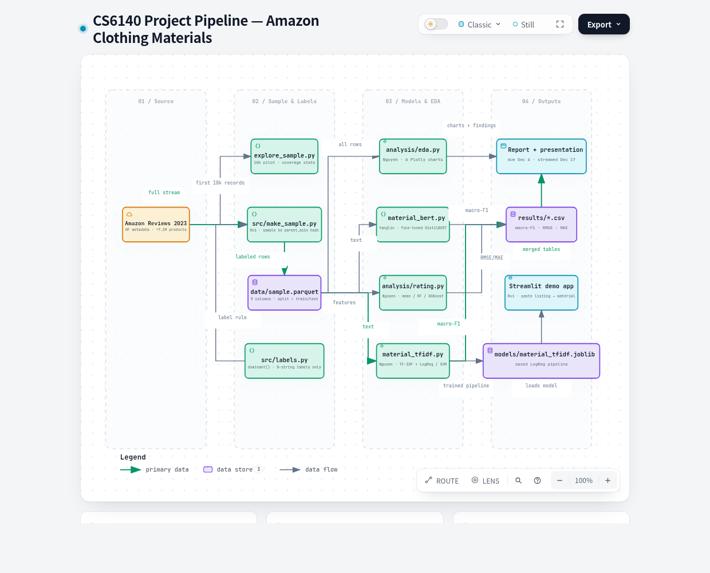
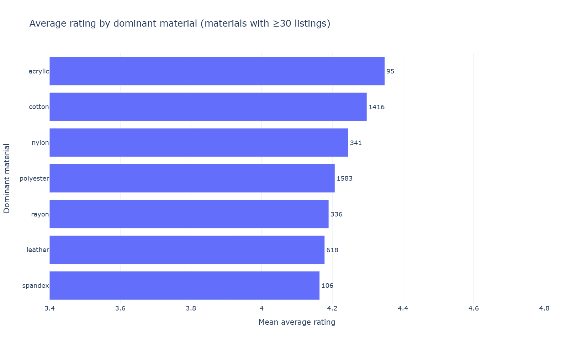
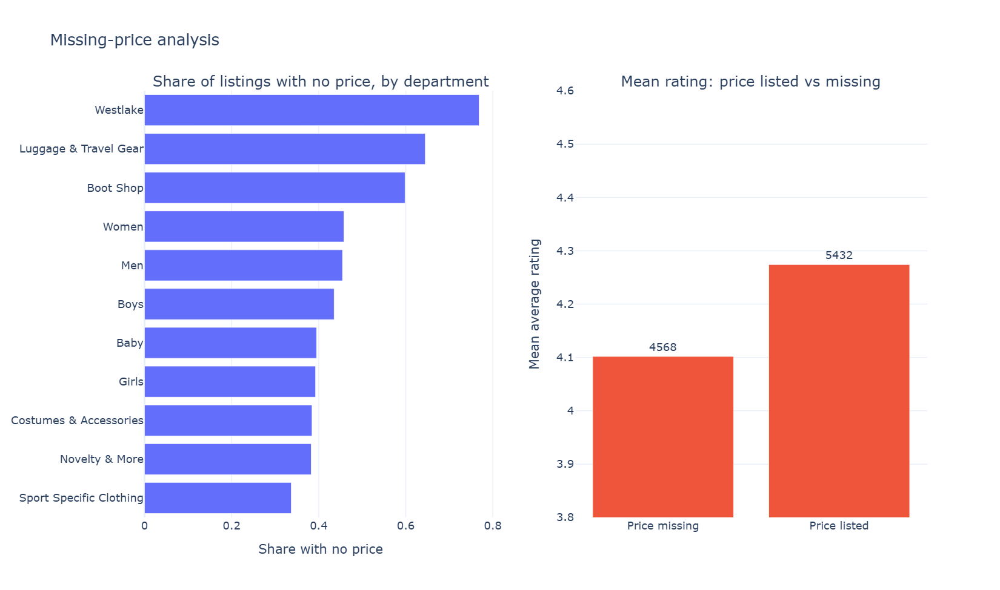

# Data analysis

We use the product metadata of the Clothing, Shoes and Jewelry category of Amazon Reviews 2023 (Hou et al.). Each record holds a title, feature bullets, a description, a price, a category path from which we take the department, the average rating, and the number of ratings. The pilot analysis below uses the first 10,000 records; the same scripts rerun unchanged on the 50,000- and 250,000-product samples.

A listing's label is the known fiber with the highest stated percentage, read from the structured details or the feature bullets: $m^* = \arg\max_{m \in \mathcal{M}} p_m$, where $p_m$ is the percentage of fiber $m$ and ties go to the fiber listed first. Listings without a composition string get no label and are left out of Task A rather than guessed. In the pilot, 4,602 of 10,000 listings (46.0%) receive a label, and the classes are strongly imbalanced, which is why Task A is scored with macro-F1 rather than accuracy.

| Material | Labeled listings | Share |
|---|---|---|
| Polyester | 1,583 | 34.4% |
| Cotton | 1,416 | 30.8% |
| Leather | 618 | 13.4% |
| Nylon | 341 | 7.4% |
| Rayon | 336 | 7.3% |
| Other (spandex, acrylic, wool, ...) | 308 | 6.7% |

The text given to the models is the title, bullets, and description joined as sentences, with every comma- or sentence-delimited clause that contains a percentage removed, in either word order ("90% Polyester" or "Polyester 88%"). The analysis caught a costly bug in an earlier version of this step: a composition clause was erased together with all text back to the previous period, and because fields were joined without one, this often took the title and earlier bullets with it, which left 726 labeled listings (16%) with empty text. After the fix no labeled listing keeps a percentage and none is empty, and the title and other bullets, which sometimes name the fiber without a percentage ("Women's Leather Loafers"), survive.

Ratings are compressed near the top of the scale: the mean is 4.20, the standard deviation 0.57, and 92% of products sit between 3.5 and 5. Material barely moves this; the mean rating by material spans only 4.16 (spandex) to 4.35 (acrylic). The spread of an average also depends strongly on how many ratings it summarizes. If one rating has variance $\sigma^2$, an average of $n_i$ ratings has variance $\sigma^2 / n_i$, and the data agree: products with at most 5 ratings (15.8% of the pilot) have a rating standard deviation of 1.08, against 0.30 for products with at least 50. We therefore weight each training product by $s_i = \log(1 + n_i)$, a softened version of the $n_i$ weighting this variance argument suggests, while keeping $n_i$ out of the features.

Prices are missing for 45.7% of listings, and not at random. The missing share of department $d$, $\pi_d = \frac{1}{n_d}\sum_{i \in d} \mathbb{1}[\text{price}_i \text{ missing}]$, ranges from 34% (Sport Specific Clothing) to 77% (Westlake) among departments with at least 100 listings, and unpriced products average 4.10 stars against 4.27 for priced ones. Dropping these rows would bias the sample, so we keep them, impute the training median, and add a has-price indicator so that the model can use the missingness itself.

Price is also heavily right-skewed, with a median of \$26, a mean of \$39, and a sample skewness $g_1 = m_3 / m_2^{3/2}$ of 18.0, where $m_k$ is the $k$-th central moment. A few very expensive items would dominate any split or distance on the raw scale, so the models receive $\log(1 + \text{price})$, which lowers the skewness to 0.76. Together these analyses fixed the feature set for Task B: log price, a has-price flag, title and text word counts, department, and the material label, with an explicit "unknown" category for unlabeled listings.
