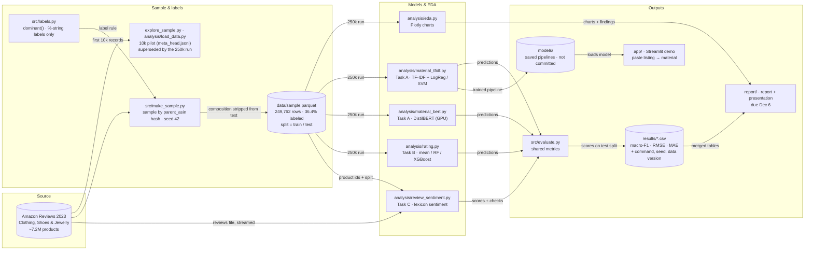
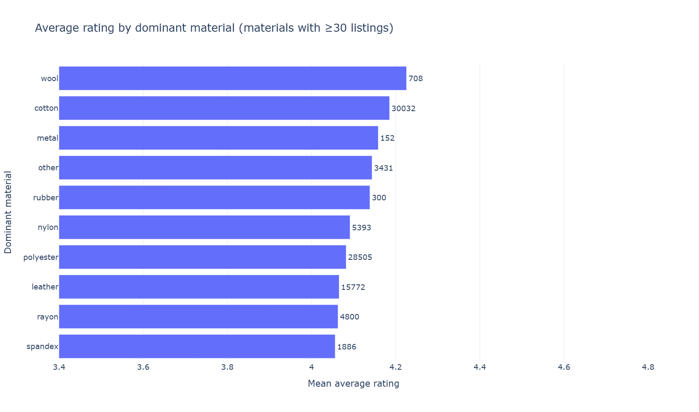

# Data analysis

*Figure: Project pipeline, from raw metadata to merged outputs. Every arrow is a step already run, including the DistilBERT 250k run on a GPU; numbers come from `data/sample.parquet` (249,762 rows) scored through `src/evaluate.py`, and the 10k pilot path serves only pilot findings labeled as such (source: `report/assets/project-pipeline.mmd`).*

We use the product metadata of the Clothing, Shoes and Jewelry category of Amazon Reviews 2023 (Hou et al.). All numbers here come from `data/sample.parquet` (249,762 rows, `make_sample.py` 2219c1e, seed 42) and were computed with `python analysis/eda.py` and short pandas commands on the output of `analysis/load_data.py` (our arithmetic).

A listing's label is the known fiber with the highest stated percentage, read from the details or feature bullets: $m^* = \arg\max_{m \in \mathcal{M}} p_m$, where $p_m$ is the percentage of fiber $m$ and ties go to the fiber listed first. Listings without a composition string get no label and are left out of Task A rather than guessed: 90,979 of 249,762 listings (36.4%) receive one, against 46.0% in the pilot. `src/labels.py` merges the fibers into ten classes, each with at least the 20 labeled listings required by `MIN_CLASS_ROWS = 20`, so none is dropped. The class list differs from the pilot's nine: it adds `other`, `rubber`, and `metal`, while acrylic and polyurethane are filed under `other`.

| Material | Labeled listings | Share |
|---|---|---|
| Cotton | 30,032 | 33.0% |
| Polyester | 28,505 | 31.3% |
| Leather | 15,772 | 17.3% |
| Nylon | 5,393 | 5.9% |
| Rayon | 4,800 | 5.3% |
| Other | 3,431 | 3.8% |
| Spandex | 1,886 | 2.1% |
| Wool | 708 | 0.8% |
| Rubber | 300 | 0.3% |
| Metal | 152 | 0.2% |

Model text joins the title, bullets, and description, with every clause containing a percentage removed. The shared `strip_composition` in `src/labels.py` removes only strings of the form "90% Polyester", so it left a percentage sign in 13,373 of the 90,979 labeled listings (14.7%). Those leftovers leak the label: a first run on insufficiently cleaned text scored macro-F1 0.6397 for logistic regression and 0.6932 for the SVM, about 0.06 and 0.07 above the cleaned scores (our arithmetic from the two runs). `analysis/load_data.py` reapplies a stricter clause filter, blanking every clause that holds a digit followed by a percent sign; its self-check (`python analysis/load_data.py`) passes. The filter leaves 405 labeled listings with empty text; we keep them.

Ratings are compressed near the top: the mean is 4.08, the standard deviation 0.75, and 84.9% of products sit between 3.5 and 5. The mean rating by material spans only 4.056 (spandex) to 4.226 (wool). If one rating has variance $\sigma^2$, an average of $n_i$ ratings has variance $\sigma^2 / n_i$: products with at most 5 ratings (34.6% of the sample) have a rating standard deviation of 1.10, against 0.34 for the 26.7% with at least 50. Task B therefore keeps only products with at least 5 ratings (dropping 30.7% of rated products) and weights each training product by $s_i = \log(1 + n_i)$. Task C exists because of what this average hides: it is computed over every review, so the results section measures how much concerns the fabric at all.

Prices are missing for 79.8% of listings, not at random: the share runs from 41.7% (Unisex Adult) to 84.5% (Unisex-adult (luggage only)) and unpriced products average 4.06 stars against 4.17 for priced ones. Among priced listings, price is right-skewed, with a median of \$22.50, a mean of \$44.80, and a maximum of \$12,500, so the models receive $\log(1 + \text{price})$. These analyses fixed the feature set for Task B: log price, a has-price flag, title and text word counts, department, and the material label, with an explicit "unknown" category for unlabeled listings.
