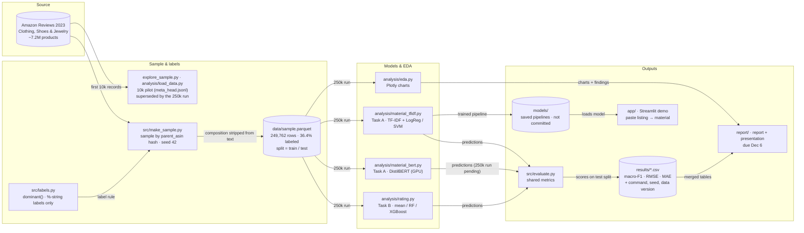
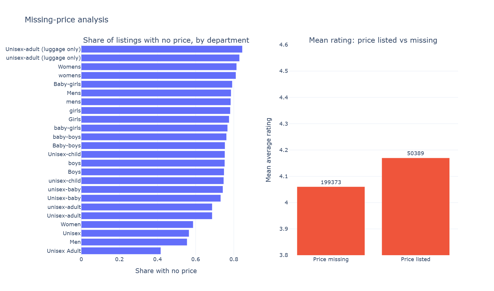

# Data analysis

*Figure: Project pipeline, from raw metadata to the sample, the three model tracks, and the merged outputs. All arrows are steps already run except the DistilBERT track, whose 250k run is still pending; the current numbers come from `data/sample.parquet` (249,762 rows) scored through `src/evaluate.py`, and the 10k pilot path is kept only for the pilot findings labeled as such (source: `report/assets/project-pipeline.mmd`).*

We use the product metadata of the Clothing, Shoes and Jewelry category of Amazon Reviews 2023 (Hou et al.). Each record holds a title, feature bullets, a description, a price, a category path, the average rating, and the number of ratings. All numbers in this section come from `data/sample.parquet` (249,762 rows, `make_sample.py` 2219c1e, seed 42), drawn by hashing each product's identifier, and were computed with `python analysis/eda.py` and short read-only pandas commands on the output of `analysis/load_data.py` (our arithmetic); findings from the earlier 10,000-record pilot are labeled as such.

A listing's label is the known fiber with the highest stated percentage, read from the structured details or the feature bullets: $m^* = \arg\max_{m \in \mathcal{M}} p_m$, where $p_m$ is the percentage of fiber $m$ and ties go to the fiber listed first. Listings without a composition string get no label and are left out of Task A rather than guessed. In the sample, 90,979 of 249,762 listings (36.4%) receive a label; in the pilot the share was 46.0%. The shared labeling code in `src/labels.py` merges the fibers into ten classes, and every class has at least the 20 labeled listings required by `MIN_CLASS_ROWS = 20`, so none is dropped. This class list differs from the pilot's nine: the larger sample adds `other` (fibers outside the named classes), `rubber`, and `metal` (sterling silver, stainless steel, gold, alloy), and acrylic and polyurethane no longer appear as separate classes because the shared rule files them under `other`. The classes remain strongly imbalanced, which is why Task A is scored with macro-F1 rather than accuracy alone.

| Material | Labeled listings | Share |
|---|---|---|
| Cotton | 30,032 | 33.0% |
| Polyester | 28,505 | 31.3% |
| Leather | 15,772 | 17.3% |
| Nylon | 5,393 | 5.9% |
| Rayon | 4,800 | 5.3% |
| Other | 3,431 | 3.8% |
| Spandex | 1,886 | 2.1% |
| Wool | 708 | 0.8% |
| Rubber | 300 | 0.3% |
| Metal | 152 | 0.2% |

The text given to the models is the title, bullets, and description joined by spaces, with every comma-, sentence-, or bullet-delimited clause that contains a percentage removed. The shared `strip_composition` in `src/labels.py` removes only strings of the form "90% Polyester", so it left a percentage sign in 13,373 of the 90,979 labeled listings (14.7%), and in 4,913 of them (by an approximate pattern) the percentage sat beside a fiber word in a form it misses, such as "80% Polyamide" or "6% Lycra Spandex". Those leftovers leak the label. `analysis/load_data.py` therefore reapplies its stricter clause filter to the text and title it reads from `data/sample.parquet` (a decimal point does not end a clause), and its self-check (`python analysis/load_data.py`) now passes: no digit followed by a percent sign remains in any labeled text. The filter blanks every clause holding a digit followed by a percent sign, which leaves 405 labeled listings (0.4%) with empty text because their whole text was such a clause; we keep them in the data. The check is limited to that pattern: 42 labeled listings (10 in the test set) still contain a stray percent sign in forms the labeling rule does not read, such as "%100 cotton" or "lOO%", and 1,048 spell out "N percent"; a stricter cleaner would need a rerun and is left for later. The first Task A run on the uncleaned text scored macro-F1 0.6397 for logistic regression and 0.6932 for the SVM, so the leak inflated macro-F1 by about 0.06 and 0.07 (our arithmetic from the two runs); all numbers in this report use the cleaned text. During the pilot we also caught a costly bug in an earlier version of this step: a composition clause was erased together with all text back to the previous period, and because fields were joined without one, this often took the title and earlier bullets with it, which left 726 labeled pilot listings (16%) with empty text.

Ratings are compressed near the top of the scale: the mean is 4.08, the standard deviation 0.75, and 84.9% of products sit between 3.5 and 5. Material barely moves this; the mean rating by material spans only 4.056 (spandex) to 4.226 (wool) across the ten classes. The spread of an average also depends strongly on how many ratings it summarizes. If one rating has variance $\sigma^2$, an average of $n_i$ ratings has variance $\sigma^2 / n_i$, and the data agree: products with at most 5 ratings (34.6% of the sample) have a rating standard deviation of 1.10, against 0.34 for the 26.7% with at least 50. We therefore weight each training product by $s_i = \log(1 + n_i)$, a softened version of the $n_i$ weighting this variance argument suggests, while keeping $n_i$ out of the features.

Prices are missing for 79.8% of listings, and not at random. The missing share of department $d$, $\pi_d = \frac{1}{n_d}\sum_{i \in d} \mathbb{1}[\text{price}_i \text{ missing}]$, ranges from 41.7% (Unisex Adult) to 84.5% (Unisex-adult (luggage only)) among the 24 departments with at least 100 listings, and unpriced products average 4.06 stars against 4.17 for priced ones. The 448 department strings also include case variants of the same department (for example "Womens" and "womens") and are missing for 12.7% of listings, which we leave as they are. Dropping the unpriced rows would bias the sample, so we keep them, impute the training median, and add a has-price indicator so that the model can use the missingness itself.

Among the priced listings, price is heavily right-skewed, with a median of \$22.50, a mean of \$44.80, a maximum of \$12,500, and a sample skewness $g_1 = m_3 / m_2^{3/2}$ of 33.8, where $m_k$ is the $k$-th central moment. A few very expensive items would dominate any split or distance on the raw scale, so the models receive $\log(1 + \text{price})$, which lowers the skewness to 0.97. Together these analyses fixed the feature set for Task B: log price, a has-price flag, title and text word counts, department, and the material label, with an explicit "unknown" category for unlabeled listings.
