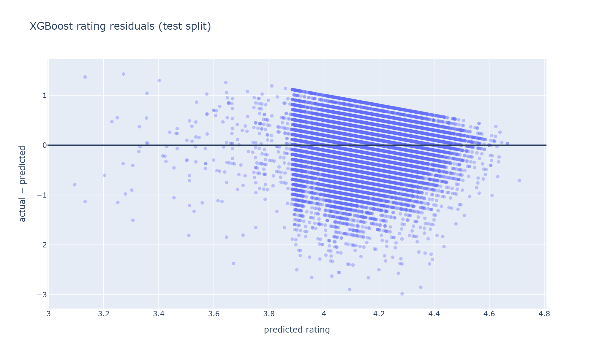

# Results

All numbers below are results on the ~250,000-product sample (data version `data/sample.parquet (249,762 rows, make_sample.py 2219c1e)`, seed 42), computed on the held-out test set through `src/evaluate.py` with `python analysis/material_tfidf.py` and `python analysis/rating.py` (files `results/material_tfidf.csv` and `results/rating.csv`). Confidence intervals are pending; they will be computed from the saved prediction files once the shared bootstrap helper is available, so until then we say "higher on this test set" and make no claim of statistical significance.

| Task A model | Macro-F1 | Accuracy | 95% CI of macro-F1 |
|---|---|---|---|
| TF-IDF + logistic regression | 0.5799 | 0.7326 | pending |
| TF-IDF + linear SVM | 0.6203 | 0.7872 | pending |

Task A has 10 classes, 72,661 training listings, and 18,318 test listings, and the text is the cleaned text described in the data analysis (no digit followed by a percent sign remains; 405 labeled listings have empty text). On this test set the linear SVM is higher than logistic regression on both macro-F1 (0.6203 against 0.5799) and accuracy (0.7872 against 0.7326), a reversal of the pilot, where logistic regression led on macro-F1 and the SVM only on accuracy. The SVM also has the higher F1 on every one of the ten classes, which we checked row by row against the saved predictions (our arithmetic), although for metal the difference is only 0.004. Overall the SVM misclassifies 3,898 test listings (21.3%) against 4,899 (26.7%) for logistic regression. The two models share their features and class weights, so the difference lies in the loss and in how the boundary is fitted; we have not tested why the SVM does better, and we did not tune either model. An earlier run on text that still held some percentage strings scored 0.6397 and 0.6932, so that leak had inflated macro-F1 by about 0.06 and 0.07 (our arithmetic from the two runs). DistilBERT has no result on this sample yet (the run by Yanglin Hu is pending), so it is not in the table above. Its pilot macro-F1 of 0.3563 was measured on the 903 test listings of the 10,000-record pilot (nine classes, different test rows), so it is not comparable with the 250k numbers.

| Material | Test listings | F1, logistic regression | F1, linear SVM |
|---|---|---|---|
| Leather | 3,188 | 0.943 | 0.953 |
| Cotton | 5,904 | 0.811 | 0.842 |
| Polyester | 5,807 | 0.693 | 0.771 |
| Rubber | 64 | 0.554 | 0.647 |
| Nylon | 1,110 | 0.589 | 0.637 |
| Wool | 169 | 0.575 | 0.605 |
| Rayon | 975 | 0.547 | 0.592 |
| Other | 688 | 0.540 | 0.577 |
| Spandex | 386 | 0.324 | 0.353 |
| Metal | 27 | 0.224 | 0.227 |

Rows are ordered by the SVM's F1. Leather is nearly solved by both models, and metal (F1 0.224 and 0.227, on only 27 test listings) and spandex (0.324 and 0.353) are the weakest classes for both. In the pilot we saw that the strongest leather terms of the logistic model were footwear words such as "sole" and "heel", so the leather class is partly a footwear class; we have not repeated that check on the 250k model. Logistic regression's precision is well below its recall on most small and mid-sized classes (for example rayon, precision 0.428 and recall 0.757, and metal, 0.136 and 0.630), because the balanced class weights make it predict those classes more often than they occur: it predicts rayon 1,726 times for 975 true rayon listings, nylon 1,612 times for 1,110, and metal 125 times for 27. The largest errors are among the three biggest fibers. Polyester was predicted as rayon 574 times, as nylon 555 times, and as cotton 549 times, and cotton as polyester 528 times, so polyester has the lowest recall of the three biggest classes (0.612, against 0.762 for cotton and 0.944 for leather). The three smallest classes have 27 (metal), 64 (rubber), and 169 (wool) test listings, so their scores move by several points with a handful of listings.

Whether the text names the fiber again separates easy from hard cases. For the 17,603 test listings of the eight classes other than `other` and `metal`, 30.8% contain the word of their own true class somewhere in the cleaned text (a word-boundary match, our arithmetic from `results/material_tfidf_predictions.csv` and the cleaned text from `analysis/load_data.py`), and logistic regression misclassifies 13.3% of those against 32.4% of the rest. This match is a cruder measure than the one we used in the pilot, so the percentages are not comparable with it.

| Task B model | RMSE | MAE | Gain in RMSE | Gain in MAE |
|---|---|---|---|---|
| Weighted mean baseline | 0.7512 | 0.5385 | — | — |
| Random forest | 0.7647 | 0.5509 | −1.8% | −2.3% |
| XGBoost | 0.7373 | 0.5234 | +1.9% | +2.8% |

Task B has 199,838 training and 49,924 test listings. The gain is $\Delta = (\text{RMSE}_{\text{base}} - \text{RMSE}_{\text{model}})/\text{RMSE}_{\text{base}}$, and likewise for MAE (our arithmetic from the rounded table values). Listing fields barely predict ratings: XGBoost has the lowest error on this test set, but only by 1.9% in RMSE and 2.8% in MAE, and the random forest is worse than the weighted mean baseline on both metrics, which reverses the pilot, where it tied the baseline. The material groups show where the error sits. The "unknown" group (listings without a label, 31,606 of the 49,924 test listings) has the largest RMSE at 0.7846, above every labeled material, whose RMSE runs from 0.5802 (other) to 0.6716 (cotton) across the groups with at least 100 test listings. The 200 largest misses are all products rated exactly 1.0 that XGBoost scores between 4.16 and 4.54; examples are a girl's graphic squid T-shirt (predicted 4.54), a nurse-slogan T-shirt (4.48), and a punk skull ring (4.44), which look from their listings like the many similar products rated 4 to 5. Those 200 products have a median of 1 rating each (maximum 3, computed from `data/sample.parquet`), so each "rating" is a single buyer's score.

We could likely do better on both tasks. For Task A, tuning $C$ and the n-gram range by cross-validation should help, and DistilBERT can use word order and context that TF-IDF ignores; we have not pursued these yet. For Task B, the average rating is a mean over very few ratings for many products (34.6% of the sample has at most 5 ratings, and 13.7% of test products are rated exactly 5.0), and no listing feature can anticipate such averages. Better Task B results would need different information, such as review text, return rates, or seller history, which our leakage rules deliberately exclude.
