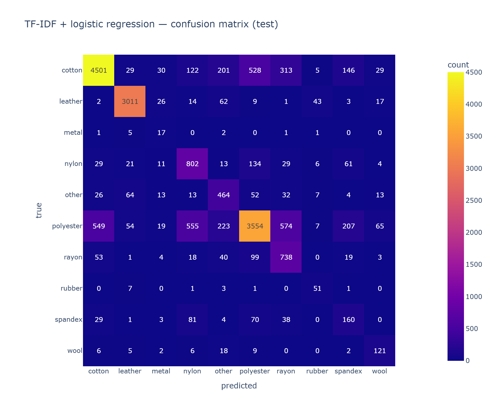
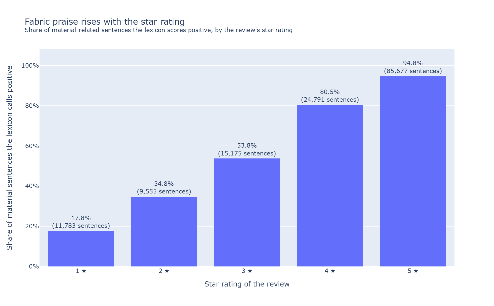

# Results

All numbers below are on the ~250,000-product sample (data version `data/sample.parquet (249,762 rows, make_sample.py 2219c1e)`, seed 42), computed on the held-out test set through `src/evaluate.py` with `python analysis/material_tfidf.py`, `python analysis/rating.py`, and `python analysis/review_sentiment.py` (files `results/material_tfidf.csv`, `results/rating.csv`, and `results/review_sentiment.csv`). Confidence intervals are pending; they will be computed from the saved prediction files once the shared bootstrap helper is available, so until then we say "higher on this test set" and make no claim of statistical significance.

| Task A model | Macro-F1 | Accuracy | 95% CI of macro-F1 |
|---|---|---|---|
| TF-IDF + logistic regression | 0.5799 | 0.7326 | pending |
| TF-IDF + linear SVM | 0.6203 | 0.7872 | pending |

Task A has 10 classes, 72,661 training listings, and 18,318 test listings. On this test set the linear SVM is higher than logistic regression on macro-F1 (0.6203 against 0.5799) and accuracy (0.7872 against 0.7326), a reversal of the pilot, with the higher F1 on every one of the ten classes (checked against the saved predictions, our arithmetic); it misclassifies 3,898 test listings (21.3%) against 4,899 (26.7%). We have not tested why the SVM does better, and we did not tune either model. DistilBERT has no result on this sample yet (the run by Yanglin Hu is pending); its pilot macro-F1 of 0.3563, on the 903 test listings of the 10,000-record pilot (nine classes, different test rows), is not comparable with the 250k numbers.

| Material | Test listings | F1, logistic regression | F1, linear SVM |
|---|---|---|---|
| Leather | 3,188 | 0.943 | 0.953 |
| Cotton | 5,904 | 0.811 | 0.842 |
| Polyester | 5,807 | 0.693 | 0.771 |
| Rubber | 64 | 0.554 | 0.647 |
| Nylon | 1,110 | 0.589 | 0.637 |
| Wool | 169 | 0.575 | 0.605 |
| Rayon | 975 | 0.547 | 0.592 |
| Other | 688 | 0.540 | 0.577 |
| Spandex | 386 | 0.324 | 0.353 |
| Metal | 27 | 0.224 | 0.227 |

Leather is nearly solved by both models; metal (only 27 test listings) and spandex are the weakest classes for both. Logistic regression's precision sits well below its recall on most small and mid-sized classes (rayon: precision 0.428, recall 0.757; metal: 0.136 and 0.630), because the balanced class weights make it predict those classes more often than they occur: rayon 1,726 times for 975 true listings, metal 125 times for 27. The largest errors are among the three biggest fibers: polyester was predicted as rayon 574 times, as nylon 555 times, and as cotton 549 times, and cotton as polyester 528 times, so polyester has the lowest recall of the three (0.612, against 0.762 for cotton and 0.944 for leather). The fiber-name split is sharp: of the 17,603 test listings in the eight classes other than `other` and `metal`, the 30.8% containing the word of their own true class are misclassified 13.3% of the time, against 32.4% of the rest (our arithmetic from the saved predictions and the cleaned text).

| Task B model | RMSE | MAE | Gain in RMSE | Gain in MAE |
|---|---|---|---|---|
| Weighted mean baseline | 0.4955 | 0.3817 | — | — |
| Random forest | 0.5044 | 0.3853 | −1.8% | −0.9% |
| XGBoost | 0.4761 | 0.3620 | +3.9% | +5.2% |

Task B keeps products with at least 5 ratings, leaving 138,355 training and 34,836 test listings (`python analysis/rating.py`, seed 42; gains are relative to the baseline, our arithmetic from the rounded table values). These errors are not comparable row for row with the earlier unfiltered run (RMSE 0.7512, 0.7647, and 0.7373), which scored a different and noisier test set; the lower values likely mostly reflect the cleaner target, not a better model. Listing fields still predict ratings only modestly: XGBoost improves on the baseline by 3.9% in RMSE and 5.2% in MAE, a gap we do not call settled until the confidence intervals are in, and the random forest is worse than the weighted mean baseline on both metrics, reversing the pilot, where it tied the baseline. The "unknown" material group (20,671 of the 34,836 test listings) has the largest RMSE at 0.4984, above every labeled material, whose RMSE runs from 0.3633 (rubber, 49 listings) to 0.4568 (polyester); among labeled groups with at least 100 test listings it runs from 0.4106 (nylon) to 0.4568. The 200 largest misses are products with a true average of 1.2 to 2.8 (median 2.3) that XGBoost scores between 3.51 and 4.44; they have 5 to 290 ratings (median 8, computed from `data/sample.parquet`), so after the filter they are no longer single-buyer scores.

## Task C: what the reviews say about the fabric

Most reviews never mention the material: of the 866,008 reviews kept for the sample's products, only 154,677 contain a material sentence, 209,830 sentences in all, and only 18.6% of 1-star reviews contain one (22.8%, 22.7%, 21.1%, and 15.8% for 2 to 5 stars), so about four in five 1-star reviews do not mention the material in words the lexicon matches (shares from `results/review_sentiment_run.json`, key `material_mention_share_by_star`). Where a material sentence does appear, the lexicon's polarity tracks the review's own star rating: the share of polar material sentences that are positive rises from 17.8% in 1-star reviews (11,783 sentences) through 34.8% and 53.8% to 80.5% in 4-star and 94.8% in 5-star reviews (85,677 sentences). A pretrained model checks the lexicon independently: DistilBERT fine-tuned on SST-2, run on the same 209,830 sentences, agrees with the lexicon's polarity on 85.3% of the 146,981 polar sentences (Cohen's kappa 0.617), with agreement lowest at 3 stars (73.1%) and highest at 5 stars (90.3%).

Across the 15,397 products with a Task C target, the Spearman correlation between the star average and material sentiment is 0.292: the two move together, but weakly. By material class (labeled products only), cotton (2,754 products) and polyester (3,348) draw the most negative fabric sentiment, at 0.773 and 0.776, and leather (392) and the `other` class (338) the least, at 0.843 and 0.841; metal (2 products) and rubber (3) are too small to read. The spread across classes is small, 0.07 from cotton to leather, against a per-product standard deviation of about 0.28. The table below predicts both targets from the same listing features, on the same 3,093 test products and with no sample weights for either target:

| Target | Model | RMSE | MAE | RMSE vs. baseline |
|---|---|---|---|---|
| Material sentiment | Mean baseline | 0.2795 | 0.2275 | 1.0000 |
| Material sentiment | XGBoost | 0.2815 | 0.2264 | 1.0072 |
| Star average | Mean baseline | 0.4695 | 0.3422 | 1.0000 |
| Star average | XGBoost | 0.4487 | 0.3194 | 0.9557 |

XGBoost did not beat the mean baseline on material sentiment (RMSE 0.7% worse, MAE 0.5% better; confidence intervals pending), while on the same products it improves the star average by 4.4% in RMSE.

Tuning $C$ and the n-gram range by cross-validation should help Task A. For Task B, no listing feature can anticipate averages built from very few ratings (before the filter 34.6% of rated products have at most 5 ratings; the filter keeps products with 5 or more, whose averages remain noisy); better results would need review text, return rates, or seller history, which our leakage rules deliberately exclude.
