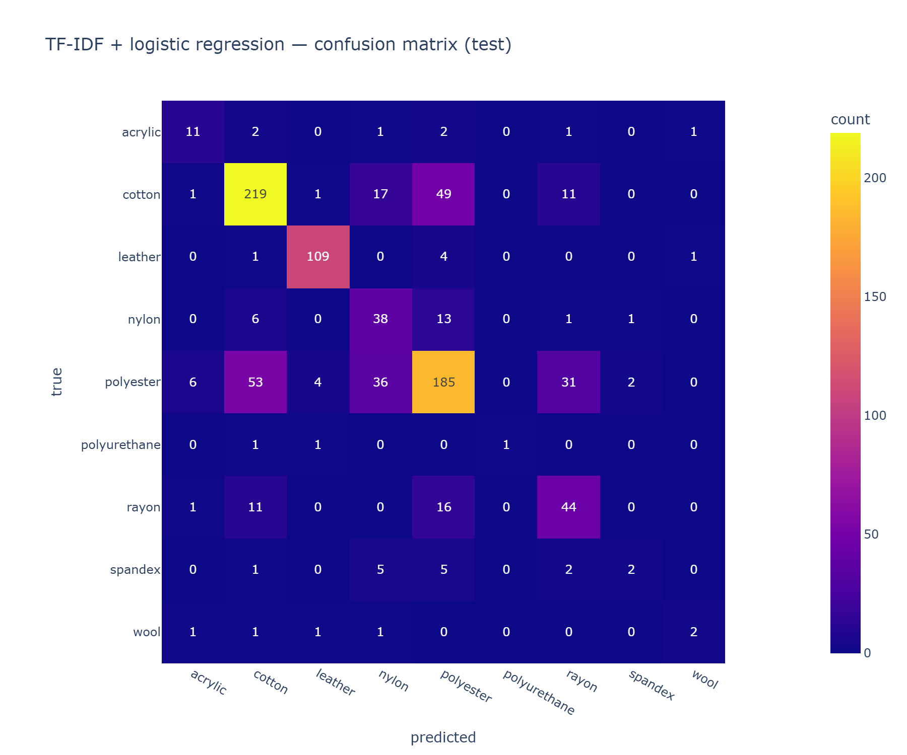
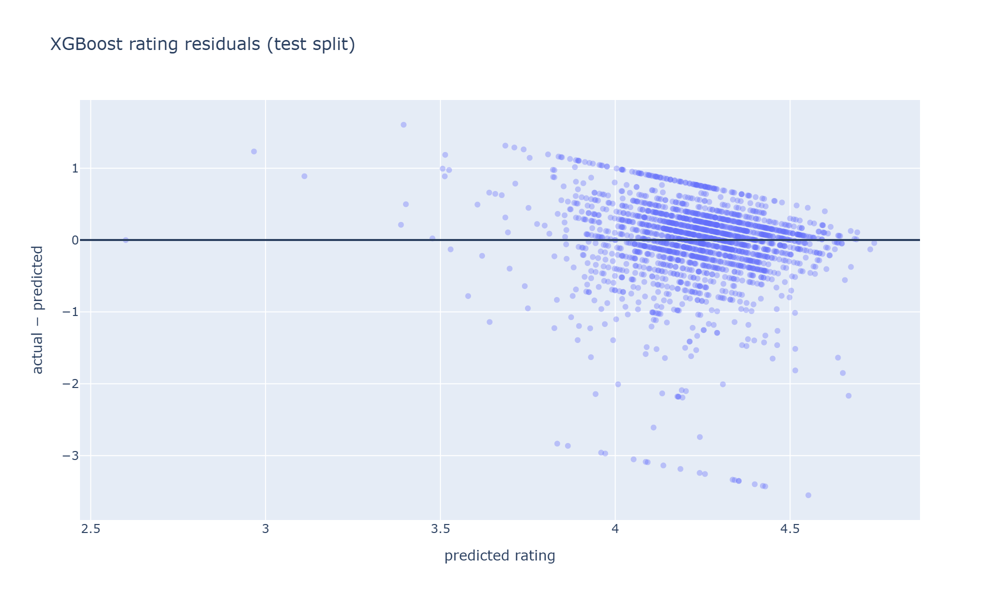

# Results

All numbers below are pilot results on the first 10,000 metadata records (data version `data/meta_head.jsonl pilot (10,000 rows)`, seed 42), computed on the held-out test set. They will be replaced by the 50,000-product sample using the same commands.

| Task A model | Macro-F1 | Accuracy |
|---|---|---|
| TF-IDF + logistic regression | 0.557 | 0.677 |
| TF-IDF + linear SVM | 0.524 | 0.736 |
| DistilBERT | pending | pending |

On Task A, logistic regression has the higher macro-F1 and the SVM the higher accuracy. Per class, the SVM is better on six of the nine materials, including acrylic and nylon; logistic regression's macro-F1 lead comes mostly from polyurethane (F1 0.500 against 0.000) and wool (0.400 against 0.250), which together have nine test listings, with rayon (0.543 against 0.496) the only other class in its favor. On the pilot the two models are therefore effectively tied. We report logistic regression in detail because its probabilities drive the demo's confidence display, and we will decide between the two on the larger sample. With 903 test listings across 9 classes, logistic regression misclassifies 292 (32%).

| Material | Test listings | F1 |
|---|---|---|
| Leather | 115 | 0.944 |
| Cotton | 298 | 0.739 |
| Polyester | 317 | 0.626 |
| Acrylic | 18 | 0.579 |
| Rayon | 72 | 0.543 |
| Polyurethane | 3 | 0.500 |
| Nylon | 59 | 0.484 |
| Wool | 6 | 0.400 |
| Spandex | 15 | 0.200 |

Leather is almost solved, and the model's strongest leather terms show why: besides "leather" itself they are "sole", "rubber sole", "heel", and "shoe", so the leather class is mostly footwear. The largest errors are between the two biggest classes: polyester was predicted as cotton 53 times and cotton as polyester 49 times, and polyester also went to nylon 36 times and to rayon 31 times. These fibers appear in the same basic garments described with the same marketing language. Whether the text names the fiber decides most errors: the 34.7% of test listings that name their own material outside the removed clauses are misclassified 22.0% of the time, against 37.8% for the rest. The three smallest classes have under 20 test listings each, so their scores move by 0.1 or more with a single listing.

| Task B model | RMSE | MAE | Gain in RMSE | Gain in MAE |
|---|---|---|---|---|
| Weighted mean baseline | 0.586 | 0.383 | — | — |
| Random forest | 0.585 | 0.385 | +0.2% | −0.4% |
| XGBoost | 0.578 | 0.374 | +1.4% | +2.6% |

The gain is $\Delta = (\text{RMSE}_{\text{base}} - \text{RMSE}_{\text{model}})/\text{RMSE}_{\text{base}}$, and likewise for MAE. Listing fields barely predict ratings: the random forest ties the baseline, and XGBoost improves it by only 1.4% in RMSE and 2.6% in MAE. Error is largest for the "unknown" material group (1,043 test listings, RMSE 0.677) and lower for every main labeled material (0.27 for rayon to 0.49 for nylon). The worst misses are products rated 1.0 that the model scores between 4.4 and 4.6, such as a graphic tee, a suitcase, and a jewelry display bust, which look from their listings exactly like the many similar products rated 4 to 5.

We could likely do better on both tasks. For Task A, the 250,000-product sample will give the rare fibers enough examples, tuning $C$ and the n-gram range by cross-validation should help, and DistilBERT can use word order and context that TF-IDF ignores; we have not pursued these yet because the pilot exists to validate the pipeline, and tuning on 10,000 records would overfit choices to a sample we are about to replace. For Task B, the residual plot shows why more modeling will not help much: its diagonal bands are products sharing the same actual rating, mostly round values such as 1.0 or 5.0, which are typical of averages over very few ratings; among the 200 largest misses the median product has only 3.5 ratings. No listing feature can anticipate such averages. Better Task B results would need different information, such as review text, return rates, or seller history, which our leakage rules deliberately exclude.
