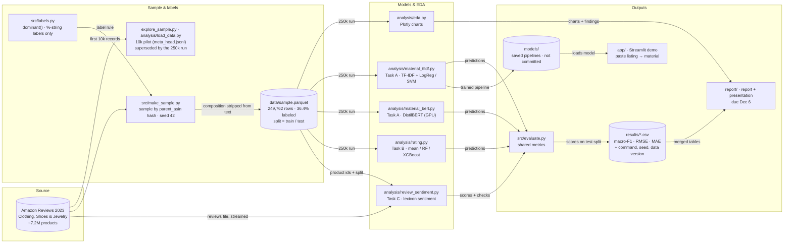

# Appendix B: Supporting detail

This appendix holds the detail that the body of the report cites but does not repeat. Every number comes from the data version `data/sample.parquet (249,762 rows, make_sample.py 2219c1e)`, seed 42, the commands listed in the first subsection, and the test set unless a line says otherwise; differences marked "our arithmetic" are computed by us from the saved files.

## B.1 Where each table in the Results section comes from

| Result | Command | Files |
|---|---|---|
| Task A, TF-IDF models | `python analysis/material_tfidf.py` | `results/material_tfidf.csv`, `results/material_tfidf_predictions.csv`, `results/material_tfidf_run.json` |
| Task A, DistilBERT and the four-model comparison | `python analysis/material_bert.py --overwrite`, then `--compare-only` and `--error-analysis` | `results/material_bert.csv`, `results/material_bert_ci.csv`, `results/material_bert_per_class.csv`, `results/material_bert_error_summary.json`, `results/material_bert_run.json` |
| Task B | `python analysis/rating.py` | `results/rating.csv`, `results/rating_predictions.csv`, `results/rating_run.json` |
| Task C | `python analysis/review_sentiment.py`; the SST-2 check is `analysis/taskc_sst2_agreement.py` | `results/review_sentiment.csv`, `results/review_sentiment_predictions.csv`, `results/review_sentiment_run.json`, `results/taskc_sst2_agreement.csv`, `results/taskc_sst2_by_rating.csv` |
| All confidence intervals except the DistilBERT ones | `python analysis/ci_from_predictions.py` (1,000 resamples, seed 42) | `results/ci_summary.csv` |

## B.2 Data analysis detail

The ten classes have the following numbers of labeled listings: cotton 30,032, polyester 28,505, leather 15,772, nylon 5,393, rayon 4,800, other 3,431, spandex 1,886, wool 708, rubber 300, and metal 152, which sum to 90,979. The pilot's nine classes differ: the 250k class list adds `other`, `rubber`, and `metal`, while acrylic and polyurethane are filed under `other`. The pilot (first 10,000 records) labeled 46.0% of listings, against 36.4% in the 250k sample. Among priced listings, price is right-skewed (median \$22.50, mean \$44.80, maximum \$12,500), so the models receive $\log(1 + \text{price})$, and the share of missing prices runs from 41.7% (Unisex Adult) to 84.5% (Unisex-adult (luggage only)).

*Figure: Project pipeline, from raw metadata to merged outputs. Every arrow is a step already run, including the DistilBERT 250k run on a GPU; numbers come from `data/sample.parquet` (249,762 rows) scored through `src/evaluate.py` (source: `report/assets/project-pipeline.mmd`).*

## B.3 Method detail

The TF-IDF vocabulary keeps word unigrams and bigrams found in at least two training listings, up to 60,000 terms. Logistic regression minimizes $\tfrac{1}{2}\lVert W \rVert^2 + C \sum_i c_{y_i}\bigl(-\log P(y_i \mid x_i)\bigr)$ with $C = 1$, where $P(y = k \mid x) = e^{w_k^\top x} / \sum_j e^{w_j^\top x}$ and $c_k = n / (K n_k)$. The linear SVM minimizes $\tfrac{1}{2}\lVert w_k \rVert^2 + C\sum_i c_i \max\bigl(0,\, 1 - y_{ik}\, w_k^\top x_i\bigr)^2$ for each class $k$ against the rest and predicts the class with the largest score. DistilBERT has 768-dimensional token vectors; we add a two-layer classification head on the first token's vector and fine-tune every weight with cross-entropy loss, AdamW, learning rate $2 \times 10^{-5}$, and batch size 16. After the epoch count is chosen on validation, a fresh model is refit on all training listings for that many epochs and predicts the test listings once; the unweighted setting had validation macro-F1 0.6784 against 0.6460 for the weighted one, with its best epoch at 3 of at most 3 (`docs/model-notes/material_bert.md`).

The Task B regression tree splits on the feature $j$ and threshold $t$ that most reduce $\sum_{i \in L} s_i (y_i - \bar{y}_L)^2 + \sum_{i \in R} s_i (y_i - \bar{y}_R)^2$ and predicts the weighted mean of each leaf. The baseline is $\bar{y} = \sum_i s_i y_i / \sum_i s_i$. XGBoost adds $\eta f_t(x_i)$ at each step $t$ under the objective $\sum_i s_i \bigl(y_i - \hat{y}_i\bigr)^2 + \sum_t \bigl(\gamma T_t + \tfrac{1}{2}\lambda \lVert v_t \rVert^2\bigr)$, where $T_t$ is the number of leaves of tree $t$ and $v_t$ its leaf values ($\gamma = 0$, $\lambda = 1$, $\eta = 0.06$). Task B and the Task C models report RMSE $= \sqrt{\frac{1}{n}\sum_i (y_i - \hat{y}_i)^2}$ and MAE $= \frac{1}{n}\sum_i \lvert y_i - \hat{y}_i\rvert$, and Task A reports macro-F1 $= \frac{1}{K}\sum_k 2P_kR_k/(P_k+R_k)$. The runs used scikit-learn 1.9.1, XGBoost 3.4.1, and pandas 3.0.6.

For Task C, each review (title plus body) is split into sentences, and a sentence counts as material-related if it names a fabric or contains a feel word that only describes fabric; ambiguous words such as thin or thick do not select a sentence on their own. Negators are not, no, never, and similar words within the three preceding words, so "not soft" scores negative and "not itchy" positive. The pretrained check replaces the lexicon with DistilBERT fine-tuned on SST-2 over the 209,830 material sentences (`analysis/taskc_sst2_agreement.py`, a Kaggle GPU notebook).

## B.4 Task A detail

| Material | Test listings | F1, logistic regression | F1, linear SVM | F1, DistilBERT | F1, DistilBERT weighted |
|---|---|---|---|---|---|
| Leather | 3,188 | 0.943 | 0.953 | 0.957 | 0.953 |
| Cotton | 5,904 | 0.811 | 0.842 | 0.848 | 0.832 |
| Polyester | 5,807 | 0.693 | 0.771 | 0.790 | 0.740 |
| Rubber | 64 | 0.554 | 0.647 | 0.702 | 0.719 |
| Nylon | 1,110 | 0.589 | 0.637 | 0.657 | 0.629 |
| Wool | 169 | 0.575 | 0.605 | 0.593 | 0.515 |
| Rayon | 975 | 0.547 | 0.592 | 0.612 | 0.597 |
| Other | 688 | 0.540 | 0.577 | 0.586 | 0.571 |
| Spandex | 386 | 0.324 | 0.353 | 0.490 | 0.519 |
| Metal | 27 | 0.224 | 0.227 | 0.524 | 0.500 |

Unweighted DistilBERT has the highest F1 on seven of the ten classes, the weighted one on spandex and rubber, and the SVM on wool (0.605 against 0.593). Against the SVM the gain is +0.006 on cotton and +0.019 on polyester, and per-class values come from `results/material_bert_per_class.csv`. The weighted DistilBERT is 0.0373 above the SVM (paired interval 0.0178 to 0.0560). Logistic regression's precision sits well below its recall on most small and mid-sized classes (rayon: precision 0.428, recall 0.757; metal: 0.136 and 0.630), because the balanced class weights make it predict those classes more often than they occur: rayon 1,726 times for 975 true listings, metal 125 times for 27. The class-weighted DistilBERT does the same for most mid-sized and small classes (nylon 1,451 predictions for 1,110 true listings, rayon 1,343 for 975, wool 266 for 169), with metal (25 for 27) the exception. For logistic regression, polyester was predicted as rayon 574 times, as nylon 555 times, and as cotton 549 times, and cotton as polyester 528 times, so polyester has the lowest recall of the three biggest fibers (0.612, against 0.762 for cotton and 0.944 for leather).

{width=60%}

On the 17,603 test listings of the eight classes other than `other` and `metal`, 30.8% contain the word of their own true class. Logistic regression misclassifies 13.3% of those listings and 32.4% of the rest, and DistilBERT errs on 5.8% of them against the SVM's 8.8%, but on 23.8% of the rest against 25.7% (a word-boundary match on the cleaned text, our arithmetic from the saved predictions). Of DistilBERT's 3,526 errors, 2,395 are also SVM errors; the two models agree on 15,041 listings, DistilBERT alone is right on 1,503 and the SVM alone on 1,131, and 2,898 of DistilBERT's 3,215 errors on the eight single-fiber classes are listings that do not name their own fiber. The largest cells of its confusion matrix are cotton predicted as polyester (641) and polyester as cotton (580). DistilBERT misclassifies 3,526 test listings (19.2%) against 3,898 (21.3%) for the SVM and 4,899 (26.7%) for logistic regression. The test set shares one `test_ids_sha256` across the TF-IDF and DistilBERT runs, and the pilot's DistilBERT score of 0.3563 (903 test listings, nine classes) is not comparable with the 250k numbers.

Three real errors show why DistilBERT is wrong. A Van Heusen cotton shirt, predicted polyester, names no material anywhere in its cleaned text ("Wrinkle-resistant and stain-repellant" is the kind of cue a model can read as synthetic); an AONIJIE nylon hydration vest, predicted polyester, names none of the 26 material names in `src/labels.py`; and a Modfine shirt labeled polyester, predicted cotton, reads "Cotton,Polyester … Material: , ." with its percentages blanked by our leakage rule, so its dominant fiber cannot be read from the text.

## B.5 Task B detail

The MAE intervals are 0.3784–0.3849 for the baseline, 0.3822–0.3884 for the random forest, and 0.3588–0.3651 for XGBoost, and the paired MAE differences from the baseline are −0.0210 to −0.0184 for XGBoost and +0.0014 to +0.0059 for the random forest. The earlier unfiltered run scored a different and noisier test set, and the lower errors of the filtered run likely mostly reflect the cleaner target, not a better model. The random forest being worse than the weighted mean baseline reverses the pilot, where it tied the baseline. The "unknown" material group (20,671 of the 34,836 test listings) has the largest RMSE at 0.4984, above every labeled material, whose RMSE runs from 0.3633 (rubber, 49 listings) to 0.4568 (polyester); among labeled groups with at least 100 test listings it runs from 0.4106 (nylon) to 0.4568 (`results/rating_residuals_by_material.csv`). The 200 largest misses are products with a true average of 1.2 to 2.8 (median 2.3) that XGBoost scores between 3.51 and 4.44; they have 5 to 290 ratings (median 8, computed from `data/sample.parquet`), so after the filter they are no longer single-buyer scores, and the listing-only model did not flag them.

## B.6 Task C detail

The share of reviews containing a material sentence is 18.6% for 1-star reviews and 22.8%, 22.7%, 21.1%, and 15.8% for 2 to 5 stars (`material_mention_share_by_star` in `results/review_sentiment_run.json`), so about four in five 1-star reviews do not mention the material in words the lexicon matches. The share of polar material sentences scored positive is 17.8% for 1-star reviews (11,783 sentences), then 34.8% and 53.8%, then 80.5% for 4-star and 94.8% for 5-star reviews (85,677 sentences). Agreement of the SST-2 model with the lexicon is 85.3% overall on the 146,981 polar sentences (Cohen's kappa 0.617), lowest at 3 stars (73.1%) and highest at 5 stars (90.3%) (`results/taskc_sst2_by_rating.csv`). The disagreements are mostly one-directional: 16,298 sentences are lexicon-positive and SST-2-negative, against 5,327 the other way. The lexicon misses words it has no entry for ("the material is so irritating" scores neutral and is dropped) and counts some shoe-part sentences as fabric feel ("the sole is soft").

{width=60%}

By material class (labeled products only), cotton (2,754 products) and polyester (3,348) draw the most negative fabric sentiment, at 0.773 and 0.776, and leather (392) and the `other` class (338) the least, at 0.843 and 0.841; metal (2 products) and rubber (3) are too small to read. The spread across classes is small, 0.07 from cotton to leather, against a per-product standard deviation of about 0.28. The 95% intervals on the 3,093 test products are RMSE 0.2715–0.2874 for the baseline and 0.2732–0.2894 for XGBoost, and MAE 0.2219–0.2332 and 0.2203–0.2323 (`python analysis/ci_from_predictions.py`, from `results/review_sentiment_predictions.csv`).

## B.7 Cleaning residue

After the stricter filter in `analysis/load_data.py`, 42 labeled listings (10 in the test set) still contain a stray percent sign in forms the labeling rule does not read, such as "%100 cotton" or "lOO%", and 1,048 spell out "N percent". A stricter cleaner is left for later, and the shared helper in `src/` should be fixed so every script is clean by default.
